<p align="center">
  
</p>

<p align="center">
  <a href="https://debasisnishank.com"><b>debasisnishank.com</b></a> ·
  <a href="https://signals.debasisnishank.com"><b>Signals</b></a> ·
  <a href="https://debasisnishank.com/resume.pdf">CV</a> ·
  <a href="https://linkedin.com/in/debasis-nishank-b47a00230">LinkedIn</a> ·
  <a href="https://www.youtube.com/@nishankmoto">YouTube</a> ·
  <a href="mailto:nishankdebasis4@gmail.com">Email</a>
</p>

## 🛰️ Mission status

```text
CALLSIGN   Debasis Nishank
STATION    AZEONICS · Full-Stack Developer & IoT / Cloud Developer (Integration)
ORBIT      Thane, India
LINK       Java · Spring · TypeScript · Python
STATUS     NOMINAL · building, shipping, riding
```

I work at [Azeonics](https://www.azeonics.com/), a home for drones, satellites and aerospace systems, *from Earth intelligence to space excellence*. My side of it is the software: multi-tenant Spring Boot services on PostgreSQL, with role-based access control and audit logging.

## 🌍 Active missions

| Mission | What it does | Stack |
|---|---|---|
| [**Khetscope**](https://github.com/debasisnishank/kissan-alert-solution) | Satellite farm advisories for Indian farmers: NDVI health scoring from Sentinel-2 and Landsat, pest ID, and voice advice in 11 Indian languages | Deno · AI · Earth observation |
| **Pothole Detection** | YOLOv8 reads dashcam video, geo-tags every pothole and exports repair data for municipal engineers | FastAPI · Computer vision · Google Cloud |
| **TRICOS** | Co-operative society platform, migrated from legacy PHP to Express 5 and hardened for production | React · Express · MySQL |
| [**Signals**](https://signals.debasisnishank.com) | A daily feed of newly released open source worth a look | Astro · JavaScript |

## 🧰 Flight systems

```text
BACKEND    Java · Spring Boot · Hibernate · Express · NestJS · Fastify · Deno · FastAPI
FRONTEND   React · Next.js · TypeScript
DATA       PostgreSQL · PostGIS · MySQL · MongoDB
IOT        MQTT · HTTP / WebSocket · LoRaWAN · BLE · Modbus · CAN
DEVICES    ESP32 · ESP8266 · Arduino · Raspberry Pi
TELEMETRY  Time-series databases · Grafana
CLOUD      Docker · Google Cloud · AWS
```

## 📡 Open channel

Always happy to talk backend and full-stack work, freelance projects, or anything ambitious: [nishankdebasis4@gmail.com](mailto:nishankdebasis4@gmail.com).

Off the clock, I'm on the bike, filming rides as [Nishank Moto](https://www.youtube.com/@nishankmoto).
